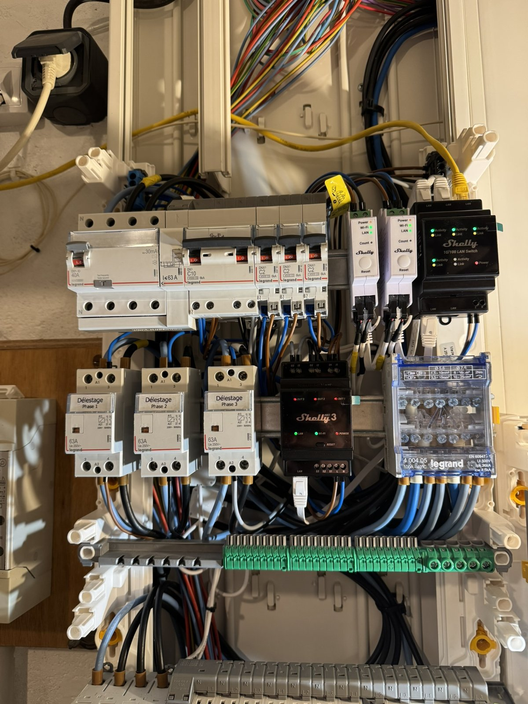
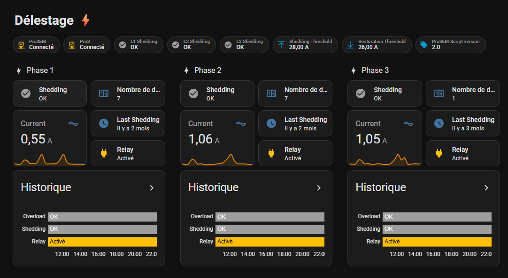

# Shelly Load Shedding

Three-phase load shedding for a home electrical panel, built on Shelly Pro devices and integrated with Home Assistant.

A Shelly Pro 3EM measures the current on each phase. When a phase goes over its threshold, the Pro 3EM tells a Shelly Pro 3 to open the contactor feeding the sheddable loads of that phase. The phase is restored once the current has dropped and a restoration delay has elapsed. A heartbeat between both devices cuts every sheddable circuit if the meter stops responding.



## How it works

```
                 Ethernet (HTTP heartbeat every 10s)
┌────────────────────────┐  GET /script/<id>/heartbeat  ┌────────────────────────┐
│   Shelly Pro 3EM       │ ───────────────────────────> │   Shelly Pro 3         │
│   load-shedder.js      │ <─────────────────────────── │   safety-protection.js │
│                        │   relay states + version     │                        │
│  CT clamps L1/L2/L3    │                              │  OUT1/OUT2/OUT3        │
│                        │  GET /rpc/Switch.Set         │                        │
│  shedding decisions    │ ───────────────────────────> │  drive contactor coils │
└──────────┬─────────────┘                              └──────────┬─────────────┘
           │ MQTT                                                  │ 230 V coil
           ▼                                                       ▼
┌────────────────────────┐                              ┌────────────────────────┐
│ MQTT broker +          │                              │ 3 × 63 A contactors    │
│ Home Assistant         │                              │ (one per phase)        │
└────────────────────────┘                              └────────────────────────┘
```

### Shedding logic (`load-shedder.js`, on the Pro 3EM)

For each phase, on every `em:0` status update:

| Condition | Action |
|---|---|
| Current > `SHEDDING_THRESHOLD` for `SHEDDING_DELAY` | Shed the phase (relay OFF) |
| Current > `SHEDDING_THRESHOLD × IMMEDIATE_SHEDDING_MULTIPLIER` | Shed immediately, without delay |
| Phase shed, current < `RESTORATION_THRESHOLD` and `RESTORATION_DELAY` elapsed since shedding | Restore the phase (relay ON) |

The gap between the two thresholds acts as hysteresis. The shedding count and last shedding time of each phase are persisted in the Pro 3EM KVS store, so they survive a reboot.

The Pro 3EM sends a heartbeat to the Pro 3 every `HEARTBEAT_INTERVAL`. The response carries the actual relay states, which keeps the Pro 3EM in sync with the Pro 3. The Pro 3 is marked offline after `MAX_CONSECUTIVE_FAILURES` failed heartbeats or when the Ethernet link goes down.

### Safety guard (`safety-protection.js`, on the Pro 3)

The Pro 3 exposes the `heartbeat` HTTP endpoint and checks every `HEARTBEAT_CHECK_INTERVAL` when the last heartbeat was received. If nothing arrived for `HEARTBEAT_TIMEOUT` (60 s), it opens all three relays. A frozen or disconnected meter can therefore never leave the loads powered without supervision. When the heartbeat comes back, the Pro 3EM restores the relays to their expected state.

The Pro 3EM detects a Pro 3 failure in about 15 s, well before the Pro 3 triggers its 60 s emergency shutdown.

### Home Assistant

The Pro 3EM publishes its state over MQTT:

| Topic | Content | Retained |
|---|---|---|
| `<prefix>/L1/state`, `<prefix>/L2/state`, `<prefix>/L3/state` | Overload, shedding, relay status, current, last shedding, shedding count | yes |
| `<prefix>/status` | Global status: all phases, Pro 3 online, script versions, thresholds | yes |
| `<prefix>/events` | One message per shedding or restoration | no |

`ha-discovery.js` publishes the Home Assistant MQTT discovery configs, which creates a "Load Shedder" device with 24 entities (per-phase overload, shedding, current, relay, last shedding, shedding count, plus connectivity, thresholds and versions).



## Hardware

| Item | Role |
|---|---|
| Shelly Pro 3EM with its 3 CT clamps | Measures the current on L1, L2, L3 and runs the shedding logic |
| Shelly Pro 3 | Three relays driving the contactor coils, runs the safety guard |
| 3 × Legrand 63 A contactors, 230 V coil | One per phase, switch the sheddable circuits |
| Second Shelly Pro 3EM (optional) | Measures the load on the sheddable circuits, not used by the scripts |
| Shelly 10/100 LAN Switch (DIN rail) | Wired Ethernet for the Shelly devices |
| MQTT broker and Home Assistant | Monitoring, history and notifications |

Both Shelly devices must be connected over Ethernet: the heartbeat only runs when the Pro 3EM has an Ethernet IP. Give both devices a fixed IP address.

The contactors are wired so that a Pro 3 relay ON keeps the phase powered. Shedding, emergency shutdown or a Pro 3 power loss all open the contactor.

> [!WARNING]
> This project involves work inside a mains electrical panel. Have the wiring done or checked by a qualified electrician, in compliance with local regulations.

## Repository layout

| File | Runs on | Purpose |
|---|---|---|
| `load-shedder.js` | Shelly Pro 3EM | Measurement, shedding and restoration logic, heartbeat, MQTT |
| `safety-protection.js` | Shelly Pro 3 | Heartbeat endpoint and emergency shutdown |
| `ha-discovery.js` | Shelly Pro 3EM (run once) | Publishes Home Assistant MQTT discovery configs |
| `ha-automations.yaml` | Home Assistant | Notifications on shedding, restoration and device offline |
| `test/` | Your computer | Integration tests against a real Pro 3EM, see [`test/README.md`](test/README.md) |

## Installation

Scripts are installed from each device web UI: `http://<device-ip>` → **Scripts** → **Create script**, paste the file content, save, start it and enable **Run on startup**.

### 1. Shelly Pro 3: `safety-protection.js`

1. Create the script, start it and enable **Run on startup**.
2. Note the script ID shown in the script URL. The heartbeat endpoint is `http://<pro3-ip>/script/<id>/heartbeat`.

### 2. Shelly Pro 3EM: `load-shedder.js`

1. Enable MQTT in **Settings → MQTT** and point it to your broker.
2. Edit `CONFIG`:

   | Key | Description |
   |---|---|
   | `PRO3_IP` | IP address of the Pro 3 (e.g. `10.0.0.101`) |
   | `PRO3_SCRIPT_ID` | Script ID of `safety-protection.js` on the Pro 3 |
   | `PHASES` | Mapping between phases, Pro 3 relay index and EM current field |
   | `SHEDDING_THRESHOLD` / `RESTORATION_THRESHOLD` | Thresholds in A, to adapt to your breakers and subscription |
   | `IMMEDIATE_SHEDDING_MULTIPLIER` | Ratio above which shedding is immediate |
   | `SHEDDING_DELAY` / `RESTORATION_DELAY` | Delays in ms (2 s and 10 s by default) |
   | `MQTT_TOPIC_PREFIX` | MQTT topic prefix, e.g. `load-shedding-<device-id>` |

3. Create the script, start it and enable **Run on startup**.

> [!CAUTION]
> `TEST_MODE` is `false` by default in both scripts. When enabled, the scripts ignore real status updates and expose unauthenticated HTTP endpoints that allow anyone on the network to inject statuses. Only enable it for the integration tests.

### 3. Home Assistant discovery: `ha-discovery.js`

1. Set `MQTT_TOPIC_PREFIX` to the same value as in `load-shedder.js`.
2. Create the script on the Pro 3EM and run it once. The console prints `=== DONE: 24 OK, 0 FAIL ===` when finished.
3. Stop and delete the script. Discovery messages are retained by the broker.

Run it again whenever the prefix or the script version changes.

### 4. Home Assistant automations: `ha-automations.yaml`

1. Copy the automations into your `automations.yaml`, or create them from the UI in YAML mode.
2. Replace the entity IDs with the ones created by discovery (`binary_sensor.<prefix>_l1_shedding`, …).
3. Replace `notify.mobile_app_*` with your own notification service.
4. Reload automations.

## Development

```bash
npm install
npm run lint
npm run format
```

Integration tests run the scripts on a real Pro 3EM with a mocked Pro 3. See [`test/README.md`](test/README.md).
